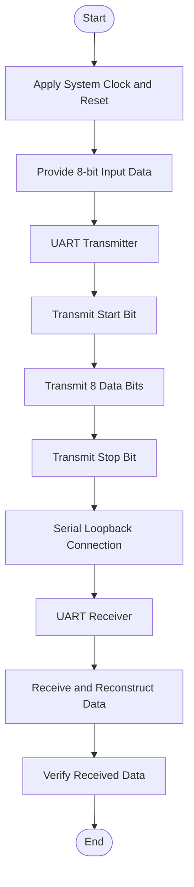

# UART Transmitter and Receiver using Verilog HDL


## 1. Project Overview

This project implements a **UART (Universal Asynchronous Receiver Transmitter) communication system** using Verilog HDL.

The design consists of a UART Transmitter (TX), UART Receiver (RX), and a Top Module that connects both modules to establish serial communication through a loopback connection.

The project was developed and simulated using **AMD Xilinx Vivado** to verify the functionality of serial data transmission and reception.

The system uses a 100 MHz system clock and operates at a baud rate of 9600 bps with an 8-N-1 communication format.

## 2. Project Objectives

- To design a UART transmitter and receiver using Verilog HDL.
- To understand serial communication and UART protocol.
- To implement Finite State Machines (FSMs) for transmission and reception.
- To generate the required baud rate using a clock divider.
- To establish loopback communication between transmitter and receiver.
- To verify the design through simulation in Vivado.

## 3. UART Communication Specifications

| Parameter | Specification |
|---|---|
| Communication Protocol | UART |
| System Clock Frequency | 100 MHz |
| Baud Rate | 9600 bps |
| Data Bits | 8 bits |
| Parity | None |
| Stop Bits | 1 |
| Data Transmission | LSB First |
| Frame Format | 8-N-1 |
| Design Language | Verilog HDL |
| Simulation Tool | AMD Xilinx Vivado |

### UART Frame Format

UART communication follows an asynchronous serial data format.

| Frame Component | Description | Logic Level |
|---|---|---|
| Start Bit | Indicates beginning of frame | 0 |
| Data Bits | Eight data bits, LSB first | 0 or 1 |
| Parity Bit | Not used | — |
| Stop Bit | Indicates end of frame | 1 |

**Data transmission order:** The least significant bit (D0) is transmitted first, followed by D1 through D7.

## 4. Baud Rate Calculation

The baud rate determines the number of bits transmitted per second.

**Given:**

- System Clock Frequency = 100 MHz
- Required Baud Rate = 9600 bps

**Formula:**

Baud Rate Divider = System Clock Frequency / Baud Rate

= 100,000,000 / 9600

= 10416.67

Therefore, the counter terminal count is approximately 10416 when counting from 0 to 10416.

This generates a baud timing interval of approximately 9600 bits per second.

## 5. System Architecture

The UART system consists of three main modules:

1. **UART Transmitter (uart_tx.v):** Converts parallel input data into serial data.
2. **UART Receiver (uart_rx.v):** Receives serial data and converts it into parallel data.
3. **Top Module (uart_top.v):** Integrates the transmitter and receiver and establishes the loopback connection.

### Architecture Diagram


### Module Description

| Module | Function |
|---|---|
| uart_tx.v | Transmits 8-bit parallel data serially |
| uart_rx.v | Receives serial data and reconstructs 8-bit data |
| uart_top.v | Connects the transmitter and receiver |
| tb.v | Testbench for simulation and verification |

## 6. Finite State Machine (FSM) Design

Both the transmitter and receiver use Finite State Machines to control UART communication.

### FSM State Diagram


### Transmitter FSM

The transmitter controls the process of converting parallel data into serial data.

| State | Description |
|---|---|
| IDLE | Waits for transmission request |
| START | Transmits the start bit (logic 0) |
| DATA | Transmits 8 data bits, LSB first |
| STOP | Transmits the stop bit (logic 1) |

### Receiver FSM

The receiver controls the process of detecting and receiving incoming serial data.

| State | Description |
|---|---|
| IDLE | Waits for the start bit |
| START | Processes the start bit |
| DATA | Receives and stores 8 data bits |
| STOP | Processes the stop bit and completes reception |

## 7. Working Principle

The UART system operates in the following sequence:

1. The transmitter receives 8-bit parallel data.
2. When transmission is initiated, the transmitter sends a start bit.
3. The eight data bits are transmitted serially, starting with the least significant bit.
4. A stop bit is transmitted to indicate the end of the frame.
5. The serial output of the transmitter is connected to the receiver through the loopback connection.
6. The receiver detects the incoming serial data and reconstructs the original 8-bit parallel data.
7. The received data is checked against the transmitted data during simulation.

### Communication Flow



## 8. Simulation and Verification

The design was simulated using **AMD Xilinx Vivado**.

The simulation verifies the complete UART loopback communication between the transmitter and receiver.

### Simulation Waveform

The waveform demonstrates the UART transmission and reception process, including serial data transfer and received parallel data.


### Verified Simulation Output

The testbench was used to verify the transmission and reception of multiple data bytes.

Test data used:

| Test Case | Transmitted Data |
|---|---|
| 1 | A5 |
| 2 | 3C |
| 3 | 55 |
| 4 | F0 |
| 5 | 00 |

### Simulation Results


**Verification Summary:**

| Parameter | Result |
|---|---|
| Total Test Cases | 5 |
| Passed | 5 |
| Failed | 0 |
| Overall Status | ALL TESTS PASSED |

The simulation results confirm that the received data matches the transmitted data for all five test cases.

## 9. Project Folder Structure

```text
UART-Transmitter-Receiver-Verilog/
│
├── uart_tx.v
├── uart_rx.v
├── uart_top.v
├── tb.v
│
├── images/
│   ├── UART Loopback System Banner.png
│   ├── architecture.jpeg
│   ├── FSM state diagram.jpeg
│   ├── Simulation.png
│   └── Verified Simulation.png
│
└── README.md
```

## 10. Tools and Technologies Used

- **Hardware Description Language:** Verilog HDL
- **Simulation and Design Tool:** AMD Xilinx Vivado
- **Design Methodology:** Finite State Machine (FSM)
- **Communication Protocol:** UART
- **Verification:** Testbench-based simulation

## 11. Applications of UART Communication

UART communication is widely used in:

- Microcontroller-to-microcontroller communication.
- Embedded systems and IoT devices.
- GPS modules and GSM modules.
- Serial communication between computers and peripherals.
- Debugging and communication interfaces.
- Sensor and peripheral interfacing.

## 12. Learning Outcomes

Through this project, I gained practical knowledge of:

- UART serial communication protocol.
- Verilog HDL-based digital design.
- Finite State Machine implementation.
- Baud rate generation using clock division.
- Serial-to-parallel and parallel-to-serial conversion.
- Testbench development and simulation verification.
- Debugging and verification using Vivado waveform analysis.


## 13. Conclusion

The UART Transmitter and Receiver project was successfully designed and simulated using Verilog HDL.

The transmitter converts parallel data into serial form, while the receiver reconstructs the original parallel data. The loopback architecture enables verification of the complete communication process.

The simulation results demonstrate successful transmission and reception of all five test data bytes, with zero failed test cases.

This project helped strengthen my understanding of digital design, serial communication protocols, FSM-based architecture, and RTL verification.

---

## Author

**Anushree Raut**

B.Tech – Electronics and Telecommunication Engineering

GitHub: [rautanushree15-ux](https://github.com/rautanushree15-ux)

---
## License

This project is licensed under the [MIT License](LICENSE).
## ⭐ Support the Project

If you find this project useful or interesting, consider giving the repository a star ⭐.

