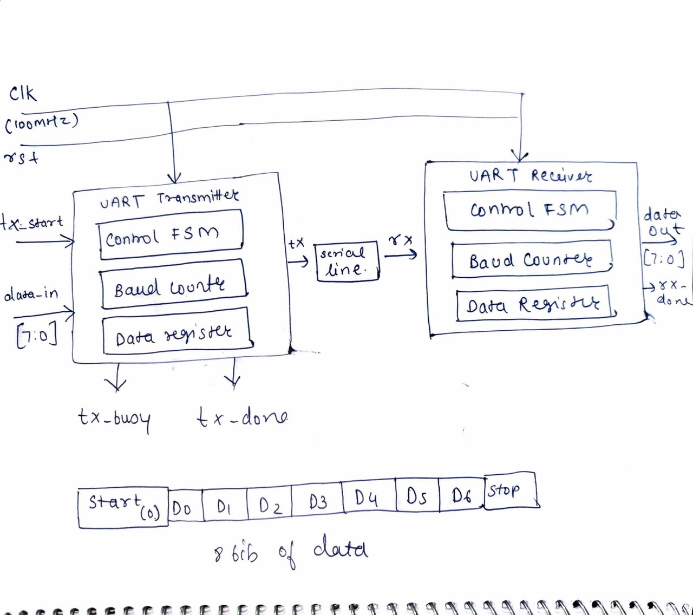
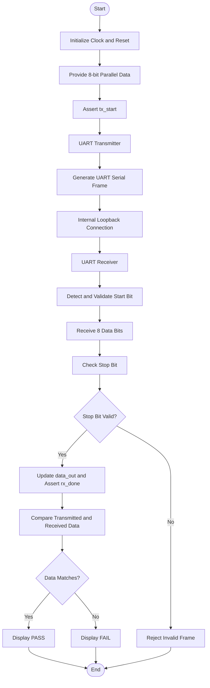
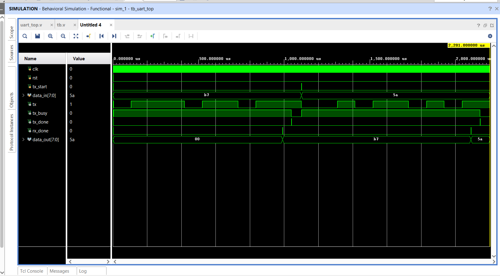

# UART Transmitter and Receiver using Verilog HDL

<p align="center">
  
</p>

<p align="center">
  <b>RTL Design and Functional Verification of UART Communication using Verilog HDL</b>
</p>

<p align="center">
  
  
  
  
  
</p>

---

## 1. Project Overview

UART (Universal Asynchronous Receiver-Transmitter) is a serial communication protocol used to transfer data between digital devices without requiring a separate clock signal between the communicating devices.

This project implements a UART Transmitter and Receiver using Verilog HDL. The transmitter converts 8-bit parallel data into serial data, while the receiver reconstructs the original 8-bit parallel data from the incoming serial stream.

The design consists of three main RTL modules:

- UART Transmitter (`uart_tx.v`)
- UART Receiver (`uart_rx.v`)
- Top-Level Module (`uart_top.v`)

The transmitter and receiver are integrated using a top-level module. The transmitter output is connected directly to the receiver input through an internal serial line, creating a loopback communication system.

The complete design is developed and functionally verified using AMD Xilinx Vivado.

## 2. Project Objectives

- To design a UART transmitter using Verilog HDL.
- To design a UART receiver using Verilog HDL.
- To implement serial communication using the UART 8-N-1 frame format.
- To understand FSM-based RTL design.
- To generate baud-rate timing using digital counters.
- To integrate transmitter and receiver modules.
- To verify data transmission and reception through loopback simulation.
- To analyze simulation waveforms and verification results.

## 3. Design Specifications

| Parameter | Specification |
|---|---|
| Communication Protocol | UART |
| Design Language | Verilog HDL |
| Clock Frequency | 100 MHz |
| Baud Rate | 9600 bps |
| Data Width | 8 bits |
| Start Bit | 1 bit (Logic 0) |
| Stop Bit | 1 bit (Logic 1) |
| Parity | None |
| Frame Format | 8-N-1 |
| Data Transmission | LSB First |
| Reset Type | Synchronous |
| Reset Polarity | Active HIGH |
| Baud Counter Width | 14 bits |
| Simulation Tool | AMD Xilinx Vivado |
| Architecture | UART Loopback |
| Verification | RTL Simulation |

---

## 4. UART Communication and Frame Format

UART is an asynchronous serial communication protocol. Data is transmitted one bit at a time.

When no data is being transmitted, the serial line remains HIGH.

Each UART frame in this project consists of:

1. One Start Bit
2. Eight Data Bits
3. One Stop Bit

There is no parity bit.

### UART Frame Format

| Field | Description | Logic Level |
|---|---|---|
| Idle | No transmission | 1 |
| Start Bit | Indicates beginning of frame | 0 |
| Data Bits | Eight data bits, LSB first | 0 or 1 |
| Parity Bit | Not used | — |
| Stop Bit | Indicates end of frame | 1 |

### UART Frame Diagram

<p align="center">
  
</p>

**Data transmission order:** The least significant bit (D0) is transmitted first, followed by D1 through D7.

---

## 5. Baud Rate Calculation

The baud rate determines the number of bits transmitted per second.

Given:

- System Clock Frequency = 100 MHz
- Baud Rate = 9600 bps

The number of clock cycles required for one UART bit is calculated using:

\[
N = \frac{f_{clk}}{Baud\ Rate}
\]

Substituting the values:

\[
N = \frac{100,000,000}{9600}
\]

\[
N = 10416.67 \approx 10417
\]

Therefore, approximately 10417 clock cycles are required for each UART bit.

### Baud Rate Parameters

| Parameter | Value |
|---|---:|
| Clock Frequency | 100 MHz |
| Baud Rate | 9600 bps |
| Clock Period | 10 ns |
| Clock Cycles per Bit | 10417 |
| Counter Initial Value | 0 |
| Counter Terminal Value | 10416 |
| Baud Counter Width | 14 bits |

### Counter Width Calculation

The baud counter must be able to represent at least 10417 values.

\[
2^{13} = 8192
\]

\[
2^{14} = 16384
\]

Since 14 bits are sufficient to represent the required count, a 14-bit counter is used.

### Receiver Half-Bit Timing

The receiver validates the start bit approximately at its midpoint.

\[
N_{half} = \frac{10417}{2} \approx 5208
\]

This allows the receiver to validate the start bit before sampling the data bits.

---

## 6. RTL Architecture

The UART system is designed using a modular RTL architecture consisting of a transmitter, receiver, and top-level module.

### RTL Architecture Diagram

<p align="center">
  
</p>

### Module Description

| Module | File Name | Function |
|---|---|---|
| UART Transmitter | `uart_tx.v` | Converts 8-bit parallel data into serial data |
| UART Receiver | `uart_rx.v` | Converts serial data into 8-bit parallel data |
| Top Module | `uart_top.v` | Integrates transmitter and receiver |
| Testbench | `tb.v` | Provides simulation inputs and verifies operation |

### Top-Level Input and Output Signals

| Signal | Direction | Width | Description |
|---|---|---:|---|
| clk | Input | 1 bit | System clock |
| rst | Input | 1 bit | Active-high synchronous reset |
| tx_start | Input | 1 bit | Initiates transmission |
| data_in | Input | 8 bits | Parallel input data |
| tx | Output | 1 bit | Serial data output |
| tx_busy | Output | 1 bit | Indicates active transmission |
| tx_done | Output | 1 bit | Indicates transmission completion |
| rx_done | Output | 1 bit | Indicates reception completion |
| data_out | Output | 8 bits | Reconstructed parallel data |

---

## 7. UART Transmitter Design

The UART transmitter converts 8-bit parallel input data into a serial data stream according to the UART frame format.

The transmitter uses a four-state Finite State Machine (FSM):

- IDLE
- START
- DATA
- STOP

### 7.1 Transmitter FSM State Table

| State | Encoding | Operation |
|---|---|---|
| IDLE | 00 | Waits for `tx_start` and keeps TX HIGH |
| START | 01 | Transmits the start bit (0) |
| DATA | 10 | Transmits 8 data bits, LSB first |
| STOP | 11 | Transmits the stop bit (1) |

### 7.2 Transmitter State Transition Table

| Present State | Condition | Next State | Operation |
|---|---|---|---|
| IDLE | tx_start = 0 | IDLE | Wait for transmission |
| IDLE | tx_start = 1 | START | Load input data |
| START | Baud count incomplete | START | Maintain TX LOW |
| START | Baud count complete | DATA | Begin data transmission |
| DATA | Bit period incomplete | DATA | Maintain current data bit |
| DATA | Bit index < 7 | DATA | Transmit next data bit |
| DATA | Bit index = 7 | STOP | Move to stop bit |
| STOP | Baud count incomplete | STOP | Maintain TX HIGH |
| STOP | Baud count complete | IDLE | Complete transmission |

### 7.3 Transmitter Internal Registers

| Register | Width | Function |
|---|---:|---|
| State Register | 2 bits | Stores the current FSM state |
| Baud Counter | 14 bits | Controls bit duration |
| Bit Index Counter | 3 bits | Selects data bits D0–D7 |
| Data Register | 8 bits | Stores input data |

### 7.4 Transmitter FSM State Diagram

<p align="center">
  
</p>

---

## 8. UART Receiver Design

The UART receiver monitors the serial input line and detects the start bit.

After detecting the falling edge of the serial line, the receiver waits approximately half a bit period to validate the start bit.

Once the start bit is validated, the receiver samples the eight data bits at their respective bit centers.

The received bits are stored in an internal data register. After all eight bits are received, the receiver checks the stop bit.

If the stop bit is valid, the reconstructed data is transferred to `data_out` and the `rx_done` signal is asserted.

### 8.1 Receiver FSM State Table

| State | Encoding | Operation |
|---|---|---|
| IDLE | 00 | Waits for the start bit |
| START | 01 | Validates the start bit |
| DATA | 10 | Receives 8 data bits |
| STOP | 11 | Checks the stop bit |

### 8.2 Receiver State Transition Table

| Present State | Condition | Next State | Operation |
|---|---|---|---|
| IDLE | rx = 1 | IDLE | Wait for start bit |
| IDLE | rx = 0 | START | Detect start bit |
| START | rx = 0 at midpoint | DATA | Valid start bit |
| START | rx = 1 at midpoint | IDLE | Invalid start bit |
| DATA | Bit index < 7 | DATA | Receive next data bit |
| DATA | Bit index = 7 | STOP | All 8 data bits received |
| STOP | rx = 1 | IDLE | Valid stop bit and complete reception |
| STOP | rx = 0 | IDLE | Invalid stop bit |

### 8.3 Receiver Internal Registers

| Register | Width | Function |
|---|---:|---|
| State Register | 2 bits | Stores the current FSM state |
| Baud Counter | 14 bits | Controls sampling intervals |
| Bit Index Counter | 3 bits | Tracks received data bits |
| Data Register | 8 bits | Stores received data |

### 8.4 FSM State Diagram

The transmitter and receiver state diagrams are illustrated in the FSM diagram above.

---

## 9. Overall Working Principle

The complete UART loopback system operates as follows:

1. The system clock and reset are initialized.
2. The transmitter waits in the IDLE state.
3. An 8-bit parallel input is provided to the transmitter.
4. The `tx_start` signal initiates transmission.
5. The transmitter generates the start bit.
6. The eight data bits are transmitted serially, LSB first.
7. The stop bit is transmitted.
8. The receiver detects the start bit on the serial line.
9. The receiver validates the start bit and samples the eight data bits.
10. The receiver checks the stop bit.
11. The received data is updated at the output.
12. The `rx_done` signal indicates successful reception.

### System Flowchart



---

## 10. Simulation and Verification

The complete UART design was simulated using AMD Xilinx Vivado.

A Verilog testbench was used to generate the clock and reset signals, provide input data, initiate transmission, and observe the received output.

The transmitter and receiver are connected internally through the loopback serial line.

### Simulation Parameters

| Parameter | Value |
|---|---|
| Simulation Tool | AMD Xilinx Vivado |
| Clock Frequency | 100 MHz |
| Clock Period | 10 ns |
| Baud Rate | 9600 bps |
| Data Width | 8 bits |
| Connection | TX-to-RX Loopback |

### Simulation Procedure

1. Generate the 100 MHz clock.
2. Apply synchronous active-high reset.
3. Provide 8-bit input data.
4. Assert `tx_start`.
5. Observe serial transmission at TX.
6. Receive serial data at RX.
7. Wait for `rx_done`.
8. Compare transmitted and received data.

---

## 11. Test Cases

Five different 8-bit data patterns were used during multi-byte functional verification.

| Test No. | Transmitted Data (Hex) | Expected Received Data (Hex) | Result |
|---:|---|---|---|
| 1 | A5 | A5 | PASS |
| 2 | 3C | 3C | PASS |
| 3 | 55 | 55 | PASS |
| 4 | F0 | F0 | PASS |
| 5 | 00 | 00 | PASS |

### Verification Summary

| Parameter | Result |
|---|---:|
| Total Test Cases | 5 |
| Passed Test Cases | 5 |
| Failed Test Cases | 0 |
| Overall Status | ALL TESTS PASSED |

---

## 12. Final Simulation Results

The final simulation was performed using Vivado Simulator.

The waveform demonstrates the UART transmission and reception process, including the serial TX signal, transmitter status signals, received parallel data, and receiver completion signal.

### 12.1 Simulation Waveform

<p align="center">
  
</p>

*Figure: UART transmitter and receiver simulation waveform.*

### 12.2 Verified Simulation with Console Output

<p align="center">
  
</p>

*Figure: Simulation waveform and console output showing successful verification.*

### Final Verification Result

- All five test cases passed.
- The received data matched the transmitted data.
- No failures were observed in the five tested patterns.

**Final Result: 5 PASS | 0 FAIL**

---

## 13. Project File Structure

```text
UART-Transmitter-Receiver-Verilog/
│
├── images/
│   ├── UART Loopback System Banner.png
│   ├── architecture.jpeg
│   ├── FSM state diagram.jpeg
│   ├── Simulation.png
│   └── Verified Simulation.png
│
├── uart_tx.v
├── uart_rx.v
├── uart_top.v
├── tb.v
│
├── README.md
└── LICENSE
```

---

## 14. Tools and Technologies Used

| Tool / Technology | Purpose |
|---|---|
| Verilog HDL | RTL design |
| AMD Xilinx Vivado | Design development and simulation |
| FSM | Sequential control logic |
| Baud Rate Counter | Bit timing generation |
| Testbench | Functional verification |
| GitHub | Source code hosting and documentation |

---

## 15. Applications of UART

- Communication between microcontrollers.
- Embedded system serial communication.
- Communication with GPS and GSM modules.
- Serial debugging and monitoring.
- Communication with sensors and peripheral devices.

---

## 16. Learning Outcomes

Through this project, the following concepts were explored:

- UART asynchronous serial communication.
- UART 8-N-1 frame format.
- Parallel-to-serial conversion.
- Serial-to-parallel conversion.
- Finite State Machine design.
- Baud-rate generation.
- Counter design and bit indexing.
- Verilog RTL coding.
- Structural module integration.
- Testbench development.
- Functional simulation and waveform analysis.

---

## 17. Conclusion

The UART transmitter and receiver were designed using Verilog HDL and integrated through a top-level RTL module.

The transmitter converts 8-bit parallel data into a serial UART frame, while the receiver reconstructs the original parallel data by detecting the start bit, sampling the data bits, and validating the stop bit.

The complete system was verified through loopback simulation using AMD Xilinx Vivado.

Five different data patterns were successfully tested, with all five test cases passing and zero failures.

This project provided practical understanding of UART communication, FSM-based RTL design, baud-rate generation, module integration, and functional verification.

---

## Author

**Anushree Raut**

B.Tech – Electronics and Telecommunication Engineering

GitHub: [rautanushree15-ux](https://github.com/rautanushree15-ux)

### Project Repository

[UART Transmitter and Receiver using Verilog HDL](https://github.com/rautanushree15-ux/UART-Transmitter-Receiver-Verilog)
